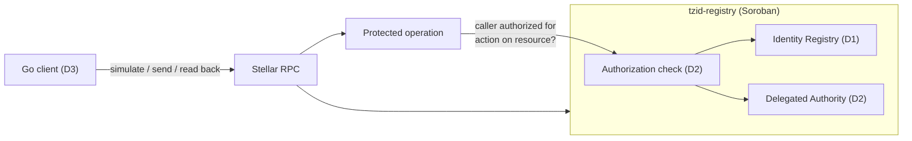

# TZID — Identity & Delegated Authority for Stellar

> **Status: pre-implementation.** Structure, specs and threat model only. No
> contract or client code yet; nothing deployed.

Open source, Soroban-native identity and scoped authorization for Stellar
applications. **One persistent identity. Explicit authority. Verifiable
delegation.**

## Problem

Wallet control alone does not establish organizational authority. Applications
need to know whether an address was delegated a specific action, whether that
authorization is still valid and whether it was revoked — without publishing
personal data onchain.

**Goal:** a permitted operation succeeds; out-of-scope, expired, revoked and
unauthorized operations fail.

## Sprint 1 (30 days)

Scope follows the Statement of Work submitted to the Stellar Community Fund
Instawards program (subject to evaluation).

| | Deliverable | Content |
|---|---|---|
| D1 | Identity Registry | Opaque identity references, controller addresses, wallet bindings. Authorized changes only. No personal data onchain. — [spec](specs/identity.md) |
| D2 | Delegated Authority | Grants to a delegate address, scoped by action/resource, with expiration and explicit revocation. A protected operation enforces the check onchain. — [spec](specs/authority.md), [check](specs/authorization.md) |
| D3 | Go integration | Testnet demo with synthetic identities: within scope (succeeds); out of scope, unauthorized, expired, revoked (fail). Tests, deployment instructions, quickstart. |

## Architecture



Details: [docs/architecture.md](docs/architecture.md).

## Principles

Security First · Privacy by Design · Identity ≠ Wallet · Relationship ≠
Permission · Least Privilege · Explicit Authorization · Verifiable Delegation ·
Reproducible Testing.

## Stack

Rust + Soroban SDK · Go · Stellar CLI and RPC · Stellar Testnet · Apache-2.0.

## Structure

```
contracts/tzid-registry/   Soroban contract (D1 + D2)
go/client/                 Go client (D3)
go/examples/               Testnet demo (D3)
specs/                     Identity, authority, authorization
docs/                      Architecture, threat model, quickstart, decisions (ADRs)
tests/                     Fixtures (synthetic only) and end-to-end tests
scripts/testnet/           Testnet helper scripts
```

## Security and privacy

- No PII, documents, passwords, recovery secrets or private keys onchain or in
  fixtures. Identifiers are never derived from personal data.
- Wallet bindings are public: linking wallets to an identity correlates them.
- Fail closed: anything not explicitly authorized is denied.
- Testnet only, unaudited. Report vulnerabilities via [SECURITY.md](SECURITY.md).

## Acceptance criteria

| ID | Criterion |
|---|---|
| A1 | Registry deployed on Testnet; contract ID and transaction references available. |
| A2 | Controller authorization verified for registration and wallet binding; unauthorized binding fails. |
| A3 | Delegated action succeeds only within scope; unrelated links grant no permission. |
| A4 | Expired and revoked authorizations fail; history remains available for audit. |
| A5 | Go integration reproduces success and failure cases on Testnet with synthetic identities. |
| A6 | Source, tests, README, quickstart and review evidence; no unresolved critical/high findings. |

## Schedule

| Week | Milestone |
|---|---|
| 1 | Final contract spec and threat model; identity/controller semantics. |
| 2 | Wallet bindings, scoped grants, expiration, revocation, negative tests. |
| 3 | Testnet deploy; Go example; allowed and denied protected operations. |
| 4 | Security and test review; reproducible instructions; demo. |

**Out of scope:** TZ55 commercial platform, tokenization, frontend, REST API,
DID method, W3C Verifiable Credentials, SEP-57, Mainnet.

## License

[Apache-2.0](LICENSE).
