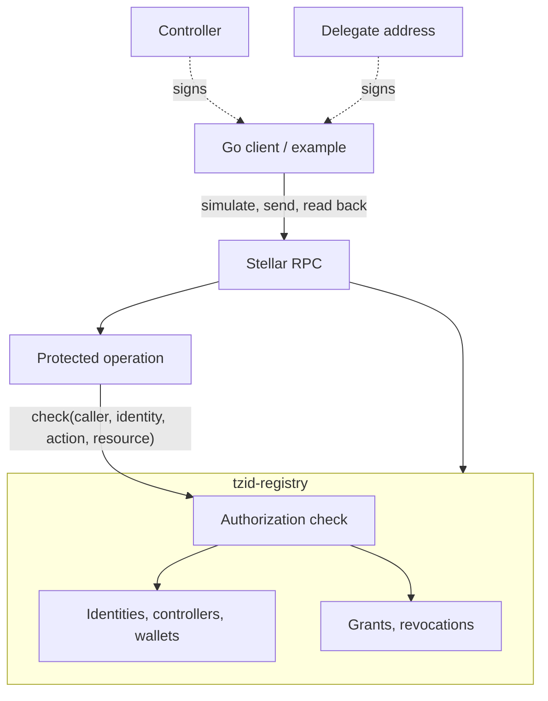
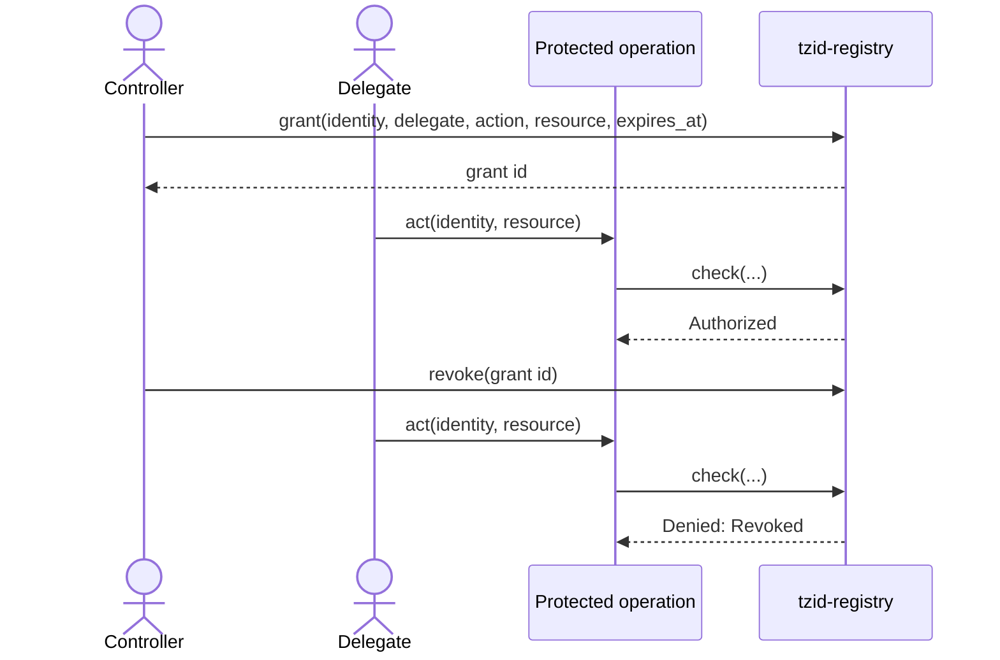

# Architecture

> Draft. Nothing implemented yet. Function names are illustrative.

| Part | Where | Role |
|---|---|---|
| `tzid-registry` | Soroban | Identities, bindings, grants and the authorization check (D1 + D2). |
| Protected operation | Soroban | Action that enforces the check onchain (D2). |
| Go client + example | Offchain | Drives the Testnet demo and reads results back (D3). |

## Components

## Grant, use, revoke

## Trust assumptions

- Anyone can submit any transaction; the contract enforces every rule.
- Soroban `require_auth` authenticates callers and prevents replay.
- RPC simulation is advisory; only included transactions are authoritative.

## Storage

Identity, wallet binding and grant entries. Hard requirements: archival never
turns a denial into an authorization, and grants are never deleted (A4).

## Open decisions

Recorded as ADRs in [decisions/](decisions/).

| # | Decision |
|---|---|
| ARCH-1 | One contract for D1 + D2, or two? |
| ARCH-2 | Upgradeable (admin key risk) or immutable? |
| ARCH-3 | Protected operation inside the registry, or in a sample consumer contract? |
| ARCH-4 | Storage type and TTL policy per entry; event schema. |
| ARCH-5 | Pinned versions: Rust, `soroban-sdk`, Stellar CLI, Go SDK. |
